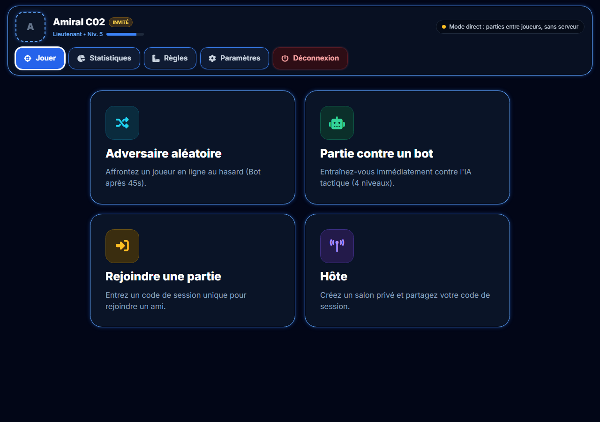
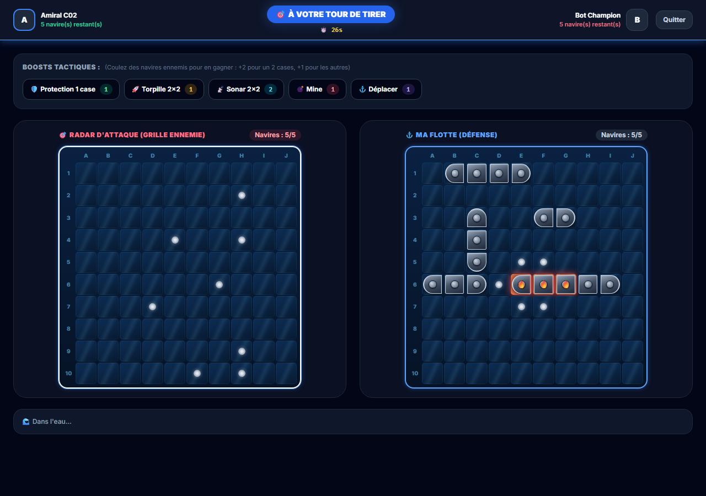

# 🚢 Warship Battle By C02

Bataille navale multijoueur dans le navigateur : **aucun téléchargement, aucune inscription obligatoire**.

### ▶️ [Jouer maintenant](https://Ghoster-001.github.io/warship-battle-by-c02/)

## Fonctionnalités

- 🤖 **Contre l'IA** : 4 niveaux (Facile, Moyen, Difficile, Champion)
- 🌍 **Adversaire aléatoire** et 🔑 **salons privés** avec un code à 6 caractères
- 📐 Grille de **6×6 à 15×15**, flotte personnalisable, chronomètre par tour (mode Blitz)
- ⚡ **5 boosts tactiques** gagnés en coulant des navires :
  🛡️ Protection d'une case · 🚀 Torpille 2×2 · 📡 Sonar 2×2 · 💣 Mine · ⚓ Déplacement
- 🏆 Niveaux, grades, statistiques, avatars (photo ou GIF) et 15 couleurs d'interface
- 🔒 Parties équitables : chaque joueur est seul à connaître sa flotte, les tirs sont arbitrés par le défenseur
  et la flotte est vérifiée en fin de partie

## Jouer avec un ami

1. Ouvrez le lien du jeu (chacun de votre côté).
2. L'un clique sur **Hôte** et partage le code à 6 caractères.
3. L'autre clique sur **Rejoindre une partie** et saisit le code.

Les deux navigateurs se connectent directement. Certains réseaux (4G/5G, entreprises) peuvent bloquer cette
connexion directe ; réessayez alors depuis un autre réseau.

## Pour les curieux

Le jeu tient dans un seul fichier, `index.html`. Le dossier du projet contient aussi un petit serveur optionnel
(`server.js`) pour des comptes en ligne et un relais des parties.

*Warship Battle By C02*